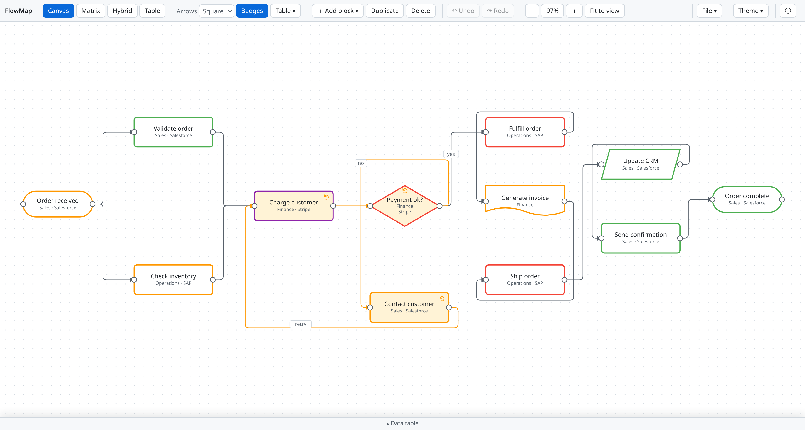
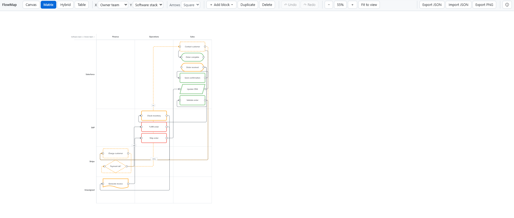
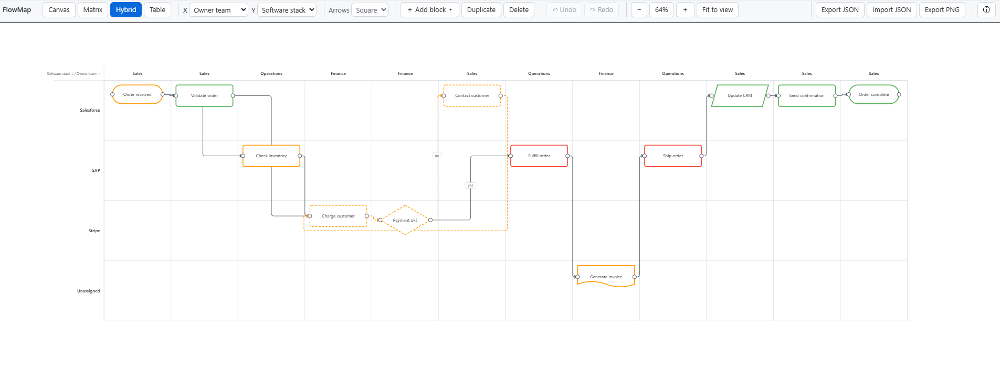
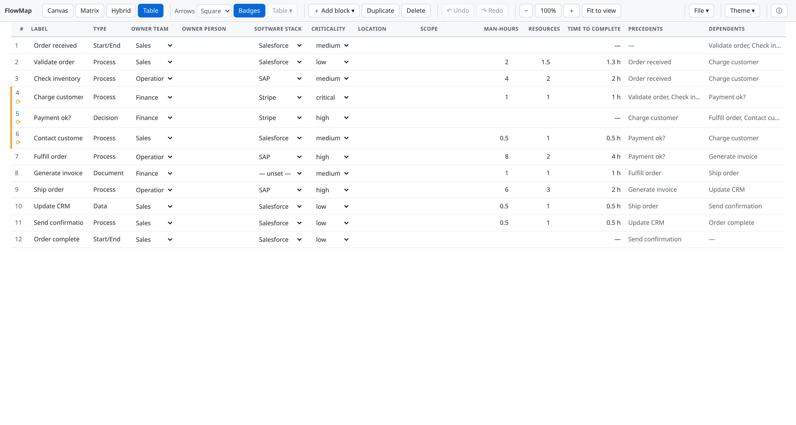

# FlowMap

**Free, open-source process flow mapping tool.** Map processes across four live views of the same data — canvas, matrix, hybrid lanes, and table. No signup, no backend: your data never leaves your browser.

## Screenshots

### Canvas — freeform design space
&lt;!-- screenshot: canvas mode --&gt;

### Matrix — pure assignment space
&lt;!-- screenshot: matrix mode --&gt;

### Hybrid — flow-ordered lanes, analysis & tweak space
&lt;!-- screenshot: hybrid mode --&gt;

### Table — every property, editable
&lt;!-- screenshot: table mode --&gt;

## Features

- **Four views, one document** — switch instantly between Canvas, Matrix, Hybrid, and Table; everything stays in sync.
- **Canvas mode** — freeform layout with a 10px snap grid, alignment guides, zoom-to-cursor, and pan.
- **Matrix mode** — pick any two properties as axes; blocks auto-arrange into cells, with an Unassigned row/column for unset values. Drag a block between cells to reassign its properties.
- **Hybrid mode** — strict Y-axis lanes with flow-ordered X bands that repeat along the process (Sales → Operations → Sales → …), so connections always read left-to-right.
- **Table mode** — activities in approximate flow order with every property as an inline-editable field.
- **Five block types** — process, decision, start/end, data, document — with criticality color-coding and owner team / software stack dropdowns that grow as you type new values.
- **Effort tracking** — man-hours and assigned resources per activity, with time-to-complete calculated automatically (man-hours ÷ resources).
- **Flow tracing** — hover any block to light up its full upstream chain (blue) and downstream chain (green); loops are flagged with an amber dashed outline.
- **Guardrails** — self-connections and duplicate connections rejected; cycles detected and visualized.
- **Full undo/redo** — 100-step history covering moves, adds, deletes, edits, connections, and reassignments.
- **Autosave + portability** — everything persists in your browser automatically; export/import as JSON, export the viewport as PNG.
- **Square or curved arrows** — orthogonal routing by default, bezier curves on demand.
- **Installable & offline** — PWA with cache-first service worker; works from a single HTML file, even from `file://`.

## Keyboard shortcuts

| Action | Shortcut |
| --- | --- |
| Undo / Redo | `Ctrl+Z` / `Ctrl+Y` or `Ctrl+Shift+Z` |
| Duplicate selection | `Ctrl+D` |
| Delete selection | `Delete` or `Backspace` |
| Clear selection | `Esc` |
| Multi-select | `Shift+click`, or drag a marquee on empty canvas |
| Pan | Middle-drag or `Space+drag` |
| Zoom to cursor | Mouse wheel |
| Rename block | Double-click its label |
| Trace flow | Hover a block |
| Manage a block's connections | Click its left (input) lead |
| Shortcuts cheat sheet | `?` |

## Privacy

**Your data stays in your browser.** FlowMap has no accounts, no backend, and no analytics of its own. Diagrams are autosaved to your browser's local storage and never transmitted anywhere — clearing your browser data deletes them permanently, so use JSON export for backups.

## Feedback

Found a bug or have an idea? [Open an issue](https://github.com/processflowmap/flowmap/issues/new/choose) — please include your browser/OS and the steps to reproduce.

Source: [github.com/processflowmap/flowmap](https://github.com/processflowmap/flowmap)
