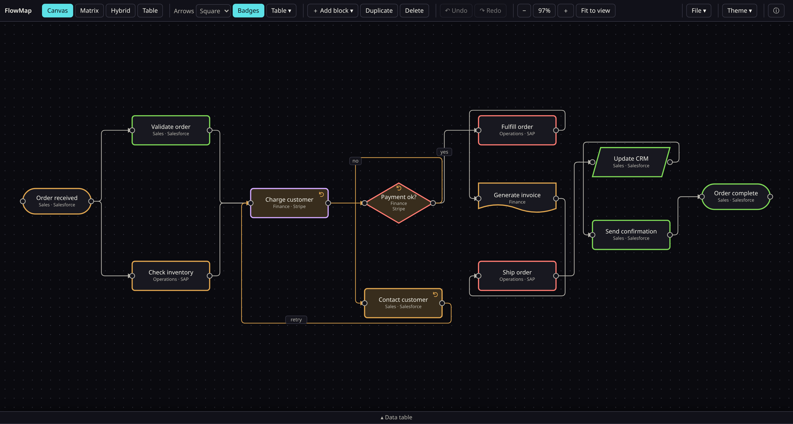
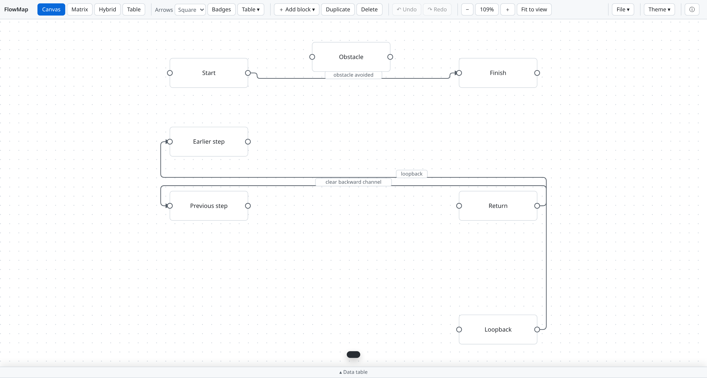
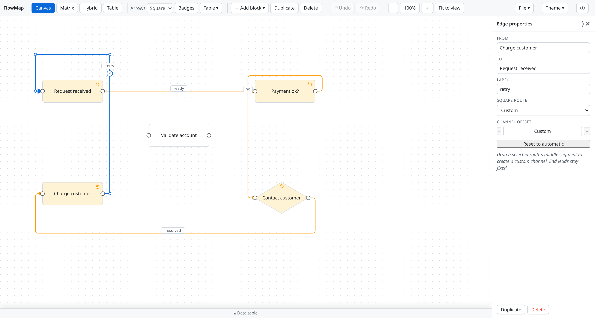
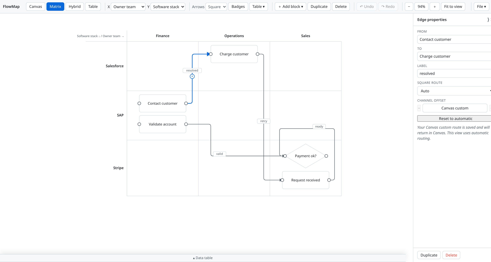
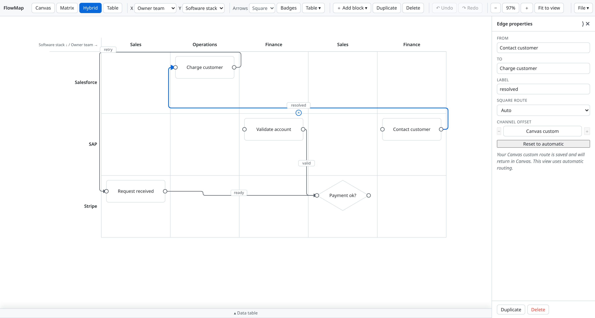
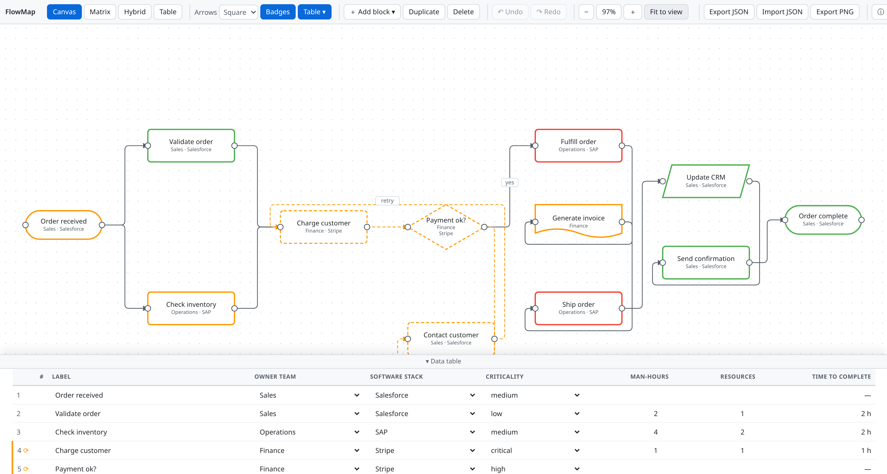

# FlowMap

**Free, open-source process flow mapping tool.** Map processes across four live views of the same data — canvas, matrix, hybrid lanes, and table. No signup, no backend: your data never leaves your browser.

## Screenshots

### Canvas — freeform design space
&lt;!-- screenshot: canvas mode --&gt;


### Dark Canvas — System, Light, and Dark appearance choices
&lt;!-- screenshot: dark canvas mode --&gt;


### Obstacle-aware Square routing
&lt;!-- screenshot: backward and obstructed Square routes --&gt;


### Custom Square routing — selected-edge controls and draggable channels
&lt;!-- screenshot: custom Square route and edge properties --&gt;


### Matrix and Hybrid — fresh automatic geometry with Canvas overrides preserved
&lt;!-- screenshots: Canvas custom routes do not leak into automatic layouts --&gt;



### Matrix — pure assignment space
&lt;!-- screenshot: matrix mode --&gt;


### Hybrid — flow-ordered lanes, analysis & tweak space
&lt;!-- screenshot: hybrid mode --&gt;


### Table — every property, editable
&lt;!-- screenshot: table mode --&gt;


### Data table drawer — abridged and editable, docked below the canvas
&lt;!-- screenshot: drawer open in canvas mode --&gt;


## Features

- **Four views, one document** — switch instantly between Canvas, Matrix, Hybrid, and Table; everything stays in sync.
- **Canvas mode** — freeform layout with a 10px snap grid, alignment guides, zoom-to-cursor, and pan.
- **Matrix mode** — pick any two properties as axes; blocks auto-arrange into cells, with an Unassigned row/column for unset values. Drag a block between cells to reassign its properties.
- **Hybrid mode** — strict Y-axis lanes with flow-ordered X bands that repeat along the process (Sales → Operations → Sales → …), so connections always read left-to-right.
- **Table mode** — activities in approximate flow order with every property as an inline-editable field.
- **Badges on blocks** *(v1.1)* — owner team and software stack render right on canvas blocks, no panel needed; toggle with the **Badges** toolbar button.
- **Data table drawer** *(v1.1)* — a collapsible, abridged, editable table docked below Canvas, Matrix, and Hybrid views; press `B` or click the grabber at the bottom of the stage.
- **Five block types** — process, decision, start/end, data, document — with criticality color-coding and owner team / software stack dropdowns that grow as you type new values.
- **Effort tracking with fractional allocation** *(v1.2)* — man-hours and any finite positive decimal resource quantity per activity, stored without rounding, with time-to-complete calculated automatically (man-hours ÷ resources).
- **Safe new-document actions** *(v1.2)* — the **File** menu consolidates blank maps, embedded curated templates, JSON import/export, and PNG export. Loading a new document validates it and asks for confirmation before replacing the current map.
- **System, Light, and Dark themes** *(v1.2.1)* — follow the operating system by default, including live changes, or choose a manual appearance from **Theme ▾**. The preference is stored separately from the diagram, and PNG export matches the active theme.
- **Flow tracing** — hover any block to light up its full upstream chain (blue/cyan) and downstream chain (green). Loop blocks use a subtle amber-tinted fill and circular-arrow marker while retaining criticality borders; cycle edges are solid amber.
- **Guardrails** — self-connections and duplicate connections rejected; cycles detected and visualized.
- **Full undo/redo** — 100-step history covering moves, adds, deletes, edits, connections, and reassignments.
- **Autosave + portability** — everything persists in your browser automatically; export/import as JSON, export the viewport as PNG.
- **Square or curved arrows** — obstacle-aware orthogonal routing by default, bezier curves on demand. Square routes avoid blocks and reduce avoidable crossings; selected edges also support Auto / Above / Below / Custom preferences, channel offsets, and draggable middle segments.
- **Installable & offline** — PWA with cache-first service worker; works from a single HTML file, even from `file://`.

## File menu

- **New blank map** — replace the current document with an empty Canvas after confirmation.
- **New from template…** — choose Blank map or any embedded curated template. The picker warns that loading replaces the current map; a separate confirmation is always required.
- **Import JSON** — replace the current document with a compatible schema-1 FlowMap JSON file.
- **Export JSON / Export PNG** — download the complete document or the current Canvas viewport.

Templates and blank maps open in Canvas, clear selection and undo/redo history, and autosave immediately. Non-empty templates are fitted to the viewport. Template data is embedded in `index.html`; no network access is required, including from `file://`.

Resource inputs accept blank (unset) or any finite number greater than zero. Decimal values such as `0.25`, `1.5`, and `2.75` are preserved across views, undo/redo, reload, and JSON round trips. Zero, negative, non-numeric, and non-finite values are rejected without changing the previous value or creating an undo entry.

## Appearance

Open **Theme ▾** and choose **System**, **Light**, or **Dark**. System is the default and responds immediately when the operating-system appearance changes. Manual choices persist in this browser under `flowmap.v1.theme`; they are not diagram properties, do not appear in JSON exports, and do not create undo entries or trigger document autosaves. Export PNG uses whichever theme is currently resolved.

## Square routing

The default Square router compares forward midlines at 25% / 50% / 75%, local and obstacle-derived channels, and deterministic channel offsets. It prioritizes avoiding block collisions, then reducing genuine edge crossings, then minimizing bends and length. Four routing orders receive bounded whole-graph refinement, and the lowest-scoring result wins. This remains a heuristic rather than a guarantee of the global minimum-crossing layout.

Select a Square edge to open its routing controls. **Auto**, **Above**, and **Below** support signed 20-unit channel offsets. In Canvas, drag a horizontal middle segment vertically or a vertical middle segment horizontally to create a **Custom** route; movement snaps to the 10-unit grid and the source/target leads remain fixed. **Reset to automatic** removes the override.

Custom interior waypoints are Canvas-specific. Matrix and Hybrid always generate fresh automatic orthogonal geometry from their current layouts and do not offer custom segment dragging. Switching views preserves the Canvas override, which returns when Canvas is reopened. Moving either endpoint in Canvas reattaches both leads horizontally without changing the chosen channel. Invalid custom geometry falls back to safe Square geometry rather than rendering diagonals. Custom routes survive undo/redo, reload, and JSON round trips; older documents without route metadata remain automatic.

Unchanged views reuse cached geometry. Active block drags use lightweight obstacle avoidance; segment drags update only the selected edge; full optimization runs on release. Curved routing and temporary pending-connection arrows retain their existing behavior.

## Contributing templates

Each curated template is an ordinary import-compatible FlowMap document with `schemaVersion: 1`, `blocks`, `edges`, valid distinct `matrix` axes, and optional `views` / `ui` preferences. Catalog metadata lives outside the document:

```json
{
  "id": "stable-lowercase-slug",
  "name": "Concise display name",
  "description": "One-sentence plain-text description.",
  "file": "source-document.json"
}
```

The catalog can contain any number of entries. For runtime integration, associate each metadata entry with its complete document in `TEMPLATE_CATALOG` in `index.html`. Do not fetch source JSON at runtime or add template files to the service-worker asset list. Serialize embedded content for an inline-script context by escaping every less-than character with its Unicode escape, and render names and descriptions only as text. Blank maps are generated by `newDoc()` and do not need a JSON document.

## Keyboard shortcuts

| Action | Shortcut |
| --- | --- |
| Undo / Redo | `Ctrl+Z` / `Ctrl+Y` or `Ctrl+Shift+Z` |
| Duplicate selection | `Ctrl+D` |
| Delete selection | `Delete` or `Backspace` |
| Clear selection | `Esc` |
| Multi-select | `Shift+click`, or drag a marquee on empty canvas |
| Pan | Middle-drag or `Space+drag` |
| Zoom to cursor | Mouse wheel |
| Rename block | Double-click its label |
| Trace flow | Hover a block |
| Manage a block's connections | Click its left (input) lead |
| Toggle data table drawer | `B` |
| Shortcuts cheat sheet | `?` |

## Privacy

**Your data stays in your browser.** FlowMap has no accounts, no backend, and no analytics of its own. Diagrams are autosaved to your browser's local storage and never transmitted anywhere — clearing your browser data deletes them permanently, so use JSON export for backups.

## Feedback

Found a bug or have an idea? [Open an issue](https://github.com/processflowmap/flowmap/issues/new/choose) — please include your browser/OS and the steps to reproduce.

Source: [github.com/processflowmap/flowmap](https://github.com/processflowmap/flowmap)
